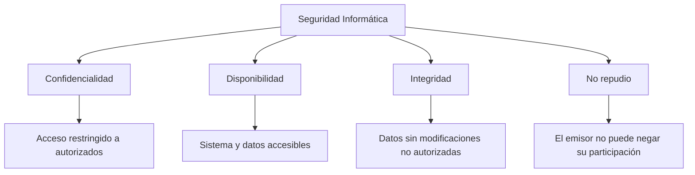
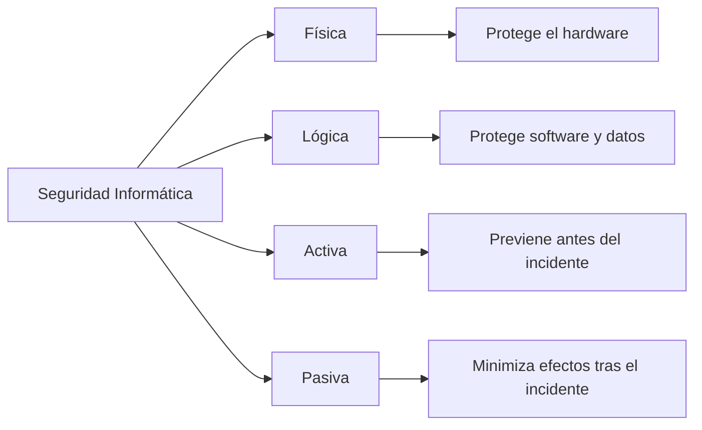
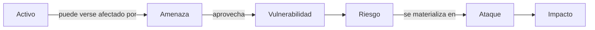
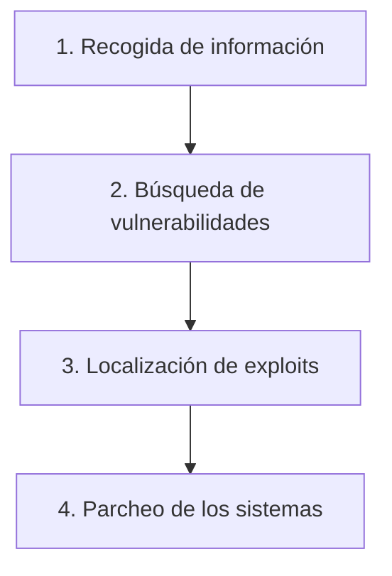
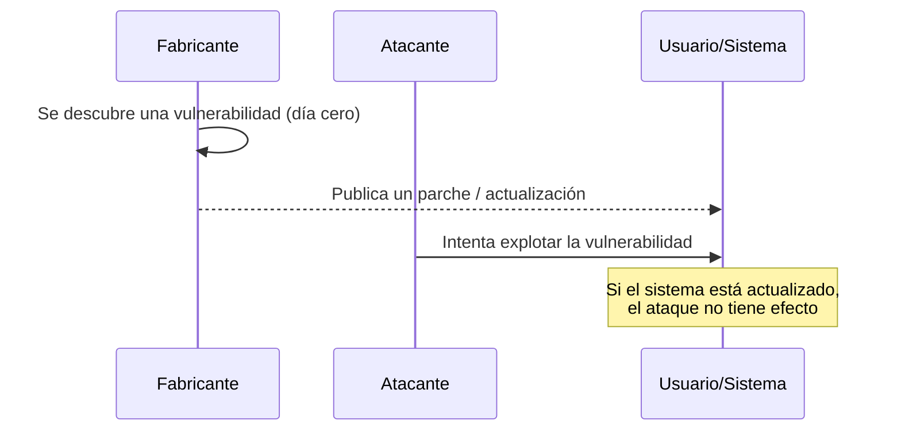
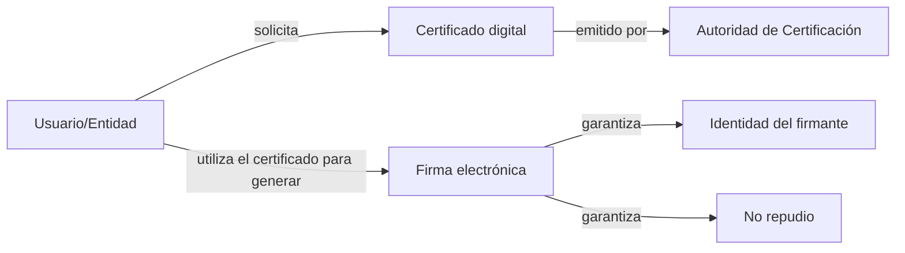
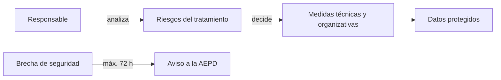

# UD01. Introducción a la seguridad informática

> **Duración:** 12 sesiones
> **RA implicados:** RA1 (seguridad pasiva), RA4 (privacidad de la información transmitida), RA5 (legislación y normativa)

## 1. Introducción

Vivimos rodeados de sistemas informáticos que gestionan información crítica: cuentas bancarias, historiales médicos, infraestructuras energéticas, sistemas de defensa, comercio electrónico, redes sociales... La dependencia de estas tecnologías hace que cualquier fallo, intrusión o pérdida de información pueda tener consecuencias económicas, legales o incluso personales muy graves.

Esta unidad introduce los **conceptos fundamentales de la seguridad informática**: qué objetivos persigue, qué terminología se utiliza para describir los riesgos a los que se enfrenta un sistema, cómo se evalúa la seguridad de una organización mediante auditorías, qué amenazas existen en forma de software malicioso y, finalmente, qué marco legal regula la protección de los datos personales y los servicios que se prestan a través de Internet.

A lo largo de la unidad desarrollaremos los siguientes bloques de contenido (manteniendo la numeración de la especificación de la UD):

| Código | Contenido |
|---|---|
| UD01-C01 | Conceptos básicos de la seguridad informática |
| UD01-C02 | Activos, amenazas, vulnerabilidades y ataques |
| UD01-C03 | Auditorías de seguridad y test de intrusión |
| UD01-C04 | Software malicioso y actualización de sistemas |
| UD01-C05 | Privacidad de la información |
| UD01-C06 | Sistemas de identificación digital |
| UD01-C07 | Legislación sobre protección de datos de carácter personal |
| UD01-C08 | Legislación sobre servicios de la sociedad de la información |

---

## 2. UD01-C01 — Conceptos básicos de la seguridad informática

<!-- content: UD01-C01 -->
*Criterios de evaluación: RA1.a, RA1.b · Origen curricular: CB1.01*

### 2.1. ¿Por qué necesitamos seguridad informática?

El auge de Internet y de los servicios telemáticos ha convertido a los ordenadores y las redes en un elemento cotidiano, tanto en los hogares como en las empresas. Prácticamente cualquier organización, sea cual sea su tamaño, depende de equipos conectados a la red para sus procesos productivos. Esto implica que **cualquier fallo de seguridad puede traducirse en una pérdida económica**, en un daño a la reputación de la empresa o en la vulneración de derechos de las personas cuyos datos se manejan.

La estrategia correcta no consiste en reaccionar únicamente cuando el problema ya ha ocurrido, sino en **adoptar medidas preventivas** que permitan anticiparse al atacante y reducir al mínimo el impacto cuando el incidente sea inevitable.

> **Analogía didáctica:** pensemos en la seguridad informática como en la seguridad de una vivienda. No basta con tener una puerta cerrada (medida preventiva); también conviene disponer de un seguro del hogar (medida paliativa) para cuando, a pesar de todo, se produzca un robo. La seguridad informática combina ambos enfoques: evitar que el incidente ocurra y, si ocurre, minimizar su efecto.

### 2.2. Definición de seguridad informática

La documentación de la unidad recoge varias formulaciones equivalentes de la definición de seguridad informática:

- El conjunto de **servicios y mecanismos** que aseguran la integridad y privacidad de la información que los sistemas manejan.
- El conjunto de **servicios, mecanismos y políticas** que garantizan que el modo de operación de un sistema sea el que se especificó en la fase de diseño o el que se configuró en tiempo de administración.
- El conjunto de **protocolos y mecanismos** que aseguran que la comunicación entre sistemas esté libre de intrusos.
- De forma más sintética: *«las medidas y controles que aseguran la confidencialidad, integridad y disponibilidad de los activos de los sistemas de información, incluyendo hardware, software, firmware y la información que procesan, almacenan y comunican»*.

En conjunto, todas estas definiciones apuntan a una misma idea: la seguridad informática no es un producto que se compra e instala una vez, sino **un proceso continuo** formado por medidas técnicas, organizativas y normativas.

### 2.3. Objetivos de la seguridad informática

La seguridad informática persigue cuatro grandes objetivos, que suelen memorizarse con el acrónimo **CIDN** (Confidencialidad, Integridad, Disponibilidad, No repudio):

| Objetivo | Garantiza que... | Ejemplo cotidiano |
|---|---|---|
| **Confidencialidad** | La información solo esté disponible para las personas autorizadas a acceder a ella. | Un expediente médico solo puede ser consultado por el personal sanitario autorizado. |
| **Disponibilidad** | El sistema y los datos estén accesibles para los usuarios cuando los necesiten. | Una tienda online debe seguir funcionando durante el Black Friday pese al aumento de tráfico. |
| **Integridad** | La información no haya sido modificada sin autorización. | Un boletín de notas no puede ser alterado por un alumno sin que quede constancia. |
| **No repudio** | El emisor de una comunicación no pueda negar haber participado en ella. | Una factura electrónica firmada digitalmente no puede ser negada por quien la emitió. |

<!-- content: UD01-C01 -->


### 2.4. Mecanismos para conseguir estos objetivos

Los objetivos anteriores se alcanzan mediante mecanismos concretos, entre los que la documentación de la unidad destaca:

- **Autenticación**: permite identificar al emisor de un mensaje, al creador de un documento o al equipo que se conecta a una red o servicio.
- **Autorización**: controla el acceso de los usuarios ya autenticados a zonas restringidas, equipos o servicios.
- **Auditoría**: verifica el correcto funcionamiento de las políticas o medidas de seguridad adoptadas (se desarrolla en profundidad en UD01-C03).
- **Cifrado/encriptación**: oculta la información transmitida por la red o almacenada en los equipos.
- **Copias de seguridad e imágenes de respaldo**: permiten recuperar la información tras un incidente.
- **Software anti-malware (antivirus)**: detecta y elimina software malicioso.
- **Cortafuegos (firewall)**: audita y evita intentos de conexión no deseados en ambos sentidos (hacia la red y desde la red).
- **Servidores proxy**: actúan como intermediarios entre la red interna y una red externa como Internet.
- **Certificados y firma electrónica**: garantizan la identidad de una persona o entidad y el no repudio.
- **Conjunto de leyes de protección de datos personales**: obligan a las empresas a asegurar la confidencialidad de la información que gestionan (desarrollado en UD01-C07).

> **Relación mecanismo–objetivo (ejercicio tipo recogido en la documentación):** una actividad habitual consiste en elaborar una tabla donde, para cada mecanismo (autenticación, cifrado, firewall, copias de seguridad...), se indique qué objetivo(s) de la seguridad (C, I, D, NR) cubre principalmente. Por ejemplo, el cifrado protege sobre todo la **confidencialidad**, mientras que las copias de seguridad protegen principalmente la **disponibilidad**.

### 2.5. Clasificación de la seguridad informática

La seguridad informática se clasifica tradicionalmente según dos ejes complementarios:

**Eje 1: según el elemento que protege**

- **Seguridad física**: protege el hardware frente a amenazas como incendios, inundaciones, cortes eléctricos, robos o catástrofes naturales. Ejemplo de mecanismo: el Sistema de Alimentación Ininterrumpida (SAI).
- **Seguridad lógica**: complementa a la física protegiendo el software, las aplicaciones y los datos de usuario (por ejemplo, mediante contraseñas, permisos de acceso o cifrado).

**Eje 2: según el momento en que actúa**

- **Seguridad activa**: conjunto de medidas que **previenen** e intentan evitar que se produzcan daños en los sistemas informáticos (contraseñas, cifrado, cortafuegos, antivirus).
- **Seguridad pasiva**: complementa a la activa y se encarga de **minimizar los efectos** una vez que el incidente ya se ha producido (copias de seguridad, SAI, sistemas de discos redundantes).

<!-- content: UD01-C01 -->


| Clasificación | Qué protege / cuándo actúa | Ejemplos |
|---|---|---|
| Física | El hardware frente a amenazas ambientales o físicas | Cámaras, extintores, control de acceso a la sala de servidores |
| Lógica | El software y los datos | Contraseñas, permisos, cifrado |
| Activa | Antes del incidente (prevención) | Firewall, antivirus, políticas de contraseñas |
| Pasiva | Después del incidente (minimización del daño) | SAI, copias de seguridad, RAID |

> **Error frecuente:** confundir "seguridad pasiva" con "no hacer nada". La seguridad pasiva **no es ausencia de medidas**, sino el conjunto de medidas orientadas a reducir el daño *una vez que el ataque o fallo ya se ha producido* (por ejemplo, restaurar una copia de seguridad tras un ataque de ransomware).

---

## 3. UD01-C02 — Activos, amenazas, vulnerabilidades y ataques

<!-- content: UD01-C02 -->
*Criterios de evaluación: RA4.b · Origen curricular: CB4.02*

### 3.1. Terminología básica de seguridad

Para analizar un incidente de seguridad de forma rigurosa es necesario dominar una terminología precisa. Son términos que se relacionan entre sí de forma causal:

| Término | Definición | Ejemplo |
|---|---|---|
| **Activo** | Elemento que pertenece a la organización y que se quiere proteger. | Datos de clientes, servidor de correo, personal, instalaciones. |
| **Amenaza** | Presencia de un factor (persona, máquina o suceso) que, si se diera la ocasión, atacaría al sistema produciéndole un daño. | Un empleado descontento, un terremoto, un atacante externo. |
| **Vulnerabilidad** | Debilidad o fallo en el diseño o configuración de un sistema que permite que una amenaza se materialice. | Un sistema operativo sin actualizar con un fallo de seguridad conocido. |
| **Riesgo** | Probabilidad de que una amenaza llegue a materializarse aprovechando una vulnerabilidad. | Probabilidad de que un servidor sin parchear sea atacado. |
| **Ataque** | La materialización efectiva de una amenaza. | La explotación real de esa vulnerabilidad por parte de un atacante. |
| **Impacto** | Consecuencia que produce un ataque sobre los activos afectados; puede ser cuantitativo (coste económico) o cualitativo (derechos de las personas). | Pérdida económica, filtración de datos personales. |

<!-- content: UD01-C02 -->


Esta cadena causal (activo → amenaza → vulnerabilidad → riesgo → ataque → impacto) es la base del **análisis de riesgos** y de la elaboración de una política de seguridad, que requiere:

1. Identificar los activos de la organización.
2. Identificar las amenazas de cada activo.
3. Identificar las vulnerabilidades existentes.
4. Identificar los requerimientos de seguridad.
5. Desarrollar un **plan de contingencia** que garantice la continuidad del negocio.

### 3.2. El plan de contingencia

El plan de contingencia determina las amenazas sobre los activos y contiene las medidas para garantizar la continuidad del negocio. Se compone de tres subplanes:

| Subplan | Momento de actuación | Ejemplo |
|---|---|---|
| **Plan de respaldo** | Antes de que la amenaza se materialice (preventivo) | Copias de seguridad periódicas, pararrayos, simulacros de incendio |
| **Plan de emergencia** | Mientras se está materializando la amenaza o justo después | Activar el sistema contra incendios, restaurar copias de inmediato |
| **Plan de recuperación** | Después del desastre | Disponer de un local alternativo, sustituir el material dañado, reinstalar aplicaciones |

### 3.3. Vulnerabilidades: tipos y tiempo de reacción

Según su grado de conocimiento, las vulnerabilidades se clasifican en:

- **Vulnerabilidades conocidas sobre software instalado**: ya documentadas por el fabricante, para las que existe solución (parche).
- **Vulnerabilidades conocidas sobre software no instalado**: conocidas, pero no afectan porque no usamos esa aplicación.
- **Vulnerabilidades aún no conocidas ("día cero")**: no han sido detectadas todavía por el fabricante; si se descubren antes que el fabricante publique un parche, son especialmente peligrosas.

Se denomina **día cero** al día en que una vulnerabilidad se hace pública. A partir de ese momento, el **tiempo de reacción** es el periodo que tarda el fabricante en ofrecer una solución (parche). Cuanto mayor es ese tiempo, mayor es la probabilidad de que la vulnerabilidad sea explotada en un ataque real.

Cada vulnerabilidad queda registrada en un **expediente de seguridad**, identificado habitualmente por un **Bugtraq ID** o por un identificador **CVE** (*Common Vulnerabilities and Exposures*), consultable en bases de datos públicas como `cve.mitre.org` o `securityfocus.com`.

El procedimiento típico de gestión de una vulnerabilidad sigue estas fases:

1. Detección y descripción de la vulnerabilidad.
2. Desarrollo de una prueba de concepto / exploit.
3. Publicación de la solución.
4. Generación del parche, *fix* o *hotfix* correspondiente.

### 3.4. Tipos de atacantes

| Perfil | Objetivo | Víctimas típicas |
|---|---|---|
| **Cracker** | Romper el sistema de seguridad de un software | Sistemas de protección de software o de grabación |
| **Phreaker** | Aprovechar de forma ilegal servicios de telecomunicaciones | Televisión de pago, telefonía |
| **Crasher** | Provocar que los sistemas dejen de funcionar (DoS) | Cualquier sistema vulnerable a denegación de servicio |
| **Hacker** | Saltarse la seguridad de un sistema para acceder a información privilegiada | Cualquier sistema o usuario |

Además, los ataques se clasifican según su **origen**:

- **Ataques internos**: realizados desde dentro de la organización (personal interno, ex-empleados, ex-administradores). Son potencialmente devastadores porque el atacante conoce el sistema.
- **Ataques externos**: pretenden aprovechar un servicio no autorizado, obtener acceso para después desarrollar un ataque interno, u obtener información privilegiada (curiosos, mercenarios).

### 3.5. Tipos de ataque

- **Aprovechamiento de software incorrecto**: se explotan fallos (*bugs*) de un programa. Se mitiga con sistemas de actualización y detección de intrusos.
- **Virus, troyanos y gusanos**: software que se ejecuta sin autorización para crear puertas traseras, dañar datos o reproducirse masivamente (se amplía en UD01-C04).
- **Amenazas físicas**: daños sobre el propio hardware.
- **Ataques basados en ingeniería social**: no explotan una debilidad técnica, sino la confianza del usuario.

### 3.6. Caso práctico: fraude mediante ingeniería social

Un caso documentado y muy representativo es el siguiente (basado en un fraude real detectado en la red social Facebook):

> Un usuario aparece etiquetado en la foto de una persona vestida de forma llamativa, junto a un mensaje del tipo *"Descubre quiénes son tus principales seguidores"* con un enlace a una aplicación. Al acceder, la aplicación solicita las credenciales del usuario y permisos para publicar en su muro y acceder a sus contactos. Tras conceder el permiso, la aplicación empieza a etiquetar automáticamente a los contactos del usuario con el mismo mensaje, logrando un efecto viral.

**Análisis del caso:**

- **Tipo de ataque**: ingeniería social, dirigido a obtener credenciales para propagarse.
- **Vulnerabilidad explotada**: el elemento humano — la confianza del usuario en un contenido aparentemente inofensivo, que le lleva a conceder permisos excesivos.
- **Amenaza**: de tipo pasivo, basada en la suplantación de identidad del usuario para lograr los fines del atacante.
- **Recomendación**: desconfiar de mensajes que apelan a la curiosidad (*"descubre quién..."*) y de aplicaciones que prometen funcionalidades que en realidad no pueden ofrecer.

Este ejemplo ilustra un principio clave recogido también en RA4.b: **la ingeniería social es, con frecuencia, más efectiva que un ataque puramente técnico**, porque ataca el eslabón más débil de cualquier sistema de seguridad: la persona.

> **Error frecuente del alumnado**: pensar que la seguridad informática se reduce a "tener antivirus". Muchos de los fraudes más extendidos (phishing, etiquetados virales, falsas promociones) no requieren ningún malware: se basan exclusivamente en manipular la confianza del usuario.

---

## 4. UD01-C03 — Auditorías de seguridad y test de intrusión

<!-- content: UD01-C03 -->
*Criterios de evaluación: RA1.a · Origen curricular: CB3.10*

### 4.1. Concepto de auditoría de seguridad

Una **auditoría de seguridad informática** es el estudio que comprende el análisis y gestión de un sistema informático para identificar, enumerar y describir las vulnerabilidades que puedan presentarse en una revisión exhaustiva de sus estaciones de trabajo, redes de comunicaciones o servidores.

La auditoría elabora un **informe** que, según la documentación de la unidad, debe contener:

1. Descripción de los activos y procesos.
2. Análisis de las relaciones entre activos o en el proceso de información.
3. Evaluación de las vulnerabilidades detectadas en cada activo.
4. Verificación del cumplimiento de la normativa aplicable.
5. Propuestas de medidas preventivas.

Para evaluar la seguridad se emplean dos tipos de herramientas:

- **Manuales**: observación, mediciones, entrevistas, pruebas.
- **Software de auditoría (CAAT)**: herramientas asistidas por ordenador para la auditoría total o parcial del sistema.

La auditoría puede realizarse:

- Por personal de la propia empresa → **auditoría interna**.
- Por una empresa especializada externa → **auditoría externa**.

Según el nivel de información de partida, se distingue entre:

- **Auditoría de caja negra**: se realiza desde fuera del sistema y sin ninguna credencial previa.
- **Auditoría de caja blanca**: se realiza desde dentro, con conocimiento e información privilegiada del sistema.

> Un **test de intrusión (PenTest)** es, por definición, un tipo de auditoría de caja negra: simula el comportamiento de un atacante externo real.

### 4.2. Fases de un test de intrusión (PenTest)

El test de intrusión evalúa la seguridad de un sistema simulando un ataque desde una fuente maliciosa. Sus fases son:

<!-- content: UD01-C03 -->


**1. Recogida de información (Footprinting)**

Consiste en obtener toda la información pública posible sobre el objetivo: buscadores, consultas DNS, registros WHOIS, traceroute (para situar al objetivo en la red y geográficamente) y técnicas de *spidering* (rastreo de páginas web, documentos y metadatos publicados por la organización).

**2. Fingerprinting**

Una vez recopilada la información pública, se intenta inferir información adicional —sistemas operativos, servicios activos, versiones de software— mediante pruebas directas sobre los servidores. Herramientas típicas: **Nmap**, **SuperScan**, **Netcat**.

**3. Búsqueda de vulnerabilidades**

Con los sistemas operativos y versiones de software identificados, se consultan bases de datos de vulnerabilidades (CVE, Secunia, SecurityFocus) o se emplean **escáneres de vulnerabilidades** como:

- Nessus
- GFI LanGuard Network Security Scanner
- Shadow Security Scanner
- E-eye Retina

**4. Localización/desarrollo de exploits**

Un *exploit* es una herramienta que aprovecha una vulnerabilidad concreta. Se compone de dos partes:

- **Cabecera**: el propio exploit, específico de cada fallo (*bug*).
- **Cuerpo (payload)**: las acciones ya programadas que se ejecutan una vez explotada la vulnerabilidad.

**Metasploit Framework** es la herramienta de referencia para este fin: combina una base de datos de cabeceras de exploits y payloads, permitiendo configurar y lanzar un exploit contra un objetivo. Se utiliza tanto por profesionales de seguridad (para realizar pentests) como por administradores (para comprobar la instalación de parches).

**5. Parcheo de los sistemas**

Última fase: corregir las vulnerabilidades detectadas siguiendo las recomendaciones del fabricante del software.

### 4.3. Resumen del procedimiento

| Fase | Objetivo | Herramientas típicas |
|---|---|---|
| Footprinting | Obtener información pública | Buscadores, DNS, WHOIS, traceroute |
| Fingerprinting | Inferir información de servicios/SO | Nmap, SuperScan, Netcat |
| Búsqueda de vulnerabilidades | Detectar fallos de seguridad | Nessus, GFI LanGuard, Retina |
| Explotación | Confirmar el riesgo real | Metasploit |
| Parcheo | Corregir el sistema | Actualizaciones del fabricante |

> **Error frecuente**: confundir un test de intrusión con un ataque malicioso real. La diferencia fundamental es la **autorización**: un PenTest se realiza siempre con el consentimiento expreso de la organización auditada y con el objetivo de mejorar la seguridad, no de causar daño.

---

## 5. UD01-C04 — Software malicioso y actualización de sistemas

<!-- content: UD01-C04 -->
*Criterios de evaluación: RA1.a · Origen curricular: CB3.09, CB3.11*

### 5.1. Software malicioso: idea general

El software malicioso (comúnmente llamado *malware*) es software que se ejecuta de forma no autorizada en un sistema con fines dañinos. Según la documentación de la unidad, entre sus finalidades típicas se encuentran:

- Crear puertas traseras (*backdoors*) que permitan el acceso posterior del atacante.
- Dañar datos del sistema.
- Reproducirse en otros sistemas de forma masiva.

La propia unidad introduce, dentro de esta clasificación general de tipos de ataque, tres grandes categorías de software malicioso:

| Tipo | Característica principal |
|---|---|
| **Virus** | Requiere la intervención de un archivo o programa "anfitrión" para ejecutarse y propagarse. |
| **Troyano** | Se presenta como un programa legítimo o útil, pero oculta una funcionalidad maliciosa (por ejemplo, abrir una puerta trasera). |
| **Gusano** | Se propaga de forma autónoma a través de la red, sin necesidad de un archivo anfitrión ni de intervención del usuario. |

> **Analogía didáctica:** el virus es como un parásito que necesita un huésped (el archivo infectado) para desplazarse; el gusano es más parecido a una plaga que se extiende sola, sin necesitar un "vehículo"; el troyano es un regalo envenenado: aparenta ser inofensivo o útil mientras oculta su verdadera función.

La protección frente al software que explota fallos (*bugs*) de los programas se consigue, según la documentación, mediante un **sistema de actualizaciones** combinado con mecanismos de **detección de intrusos**.

### 5.2. La importancia de mantener los sistemas actualizados

Como se ha visto en UD01-C02, una vulnerabilidad conocida y no parcheada es una puerta abierta para un ataque. Mantener los sistemas actualizados es, por tanto, una de las medidas de seguridad activa más sencillas y a la vez más eficaces.

Las pautas de protección recogidas en la documentación incluyen:

- Actualizaciones periódicas del sistema operativo y de las aplicaciones.
- Uso de cortafuegos.
- No instalar software ilegal o de procedencia no verificada.
- Formar al usuario de la empresa en buenas prácticas.
- Realizar copias de seguridad periódicas.

En entornos Windows, herramientas como **Windows Update** se encargan de distribuir los parches de seguridad; además, utilidades como **System File Checker (`sfc /verifyonly`, `sfc /scannow`)** permiten comprobar la integridad de los archivos del sistema, verificando que no han sido alterados por software malicioso o por un fallo del propio sistema.

```text
# Comprobar (sin modificar) la integridad de los archivos protegidos del sistema
sfc /verifyonly

# Comprobar y reparar automáticamente los archivos del sistema dañados
sfc /scannow
```

En sistemas basados en Unix/Linux, el comando equivalente de comprobación del sistema de archivos es **`fsck`** (*file system check*), utilizado para comprobar y reparar la estructura del sistema de archivos.

### 5.3. Relación entre vulnerabilidad conocida y actualización

<!-- content: UD01-C04, UD01-C02 -->


> **Error frecuente:** pensar que tener un antivirus instalado hace innecesario actualizar el sistema operativo o las aplicaciones. El antivirus detecta malware ya conocido, pero **no corrige las vulnerabilidades** del software; solo la actualización del propio fabricante elimina el fallo de origen.

---

## 6. UD01-C05 — Privacidad de la información

<!-- content: UD01-C05 -->
*Criterios de evaluación: RA4.b · Origen curricular: CB4.01*

### 6.1. La confidencialidad como base de la privacidad

Como ya se ha definido en UD01-C01, la **confidencialidad** es el objetivo de la seguridad informática que garantiza que la información almacenada en un sistema o transmitida por una red **solo esté disponible para las personas autorizadas a acceder a ella**.

La **privacidad de la información** es la aplicación práctica de este principio al tratamiento de información personal o sensible: no basta con que la información exista de forma segura, sino que su acceso y su circulación deben estar controlados en todo momento, especialmente cuando esa información viaja por una red.

### 6.2. Privacidad en la información transmitida

Uno de los momentos más vulnerables para la información es precisamente el de su **transmisión**: mientras un dato viaja por una red (interna o Internet), puede ser interceptado si no se aplican medidas adecuadas. Por ello, asegurar la privacidad de la información transmitida (RA4) implica, entre otras medidas:

- **Cifrado de las comunicaciones**, de forma que, aunque un atacante intercepte los datos, no pueda interpretarlos.
- **Autenticación de los extremos** de la comunicación, para evitar suplantaciones.
- **Control del acceso a los servicios de red**, inventariando qué servicios están expuestos y quién puede acceder a ellos.

> Esta unidad presenta la privacidad de forma introductoria; su desarrollo técnico completo (protocolos de cifrado, redes inalámbricas, cortafuegos) corresponde a unidades posteriores del módulo, donde se retoma el RA4 en profundidad.

### 6.3. Relación con la autenticación mediante contraseñas

Un mecanismo básico para proteger la privacidad de la información es el control de acceso mediante **usuario y contraseña**: cada usuario dispone de un identificador y una clave que permiten comprobar su identidad (autenticación) antes de concederle acceso a la información. La seguridad del sistema depende en gran medida de una buena elección de la contraseña y de su confidencialidad.

La siguiente tabla (de la documentación de la unidad) ilustra, de forma orientativa, cómo el tiempo necesario para descubrir una contraseña por fuerza bruta depende tanto de su longitud como de la variedad de caracteres empleados:

| Nº de caracteres | Solo minúsculas | Mayúsculas + minúsculas + caracteres especiales |
|---|---|---|
| 3 | Un suspiro | 1 segundo |
| 4 | Un suspiro y medio | 2 minutos |
| 5 | 10 segundos | Sobre 2 horas |
| 6 | 5 minutos | Sobre 9 días |
| 7 | Sobre 2 horas | Entre 2 y 3 años |
| 8 | Menos de 3 días | Alrededor de 2 siglos |

**Conclusión didáctica:** cuanto mayor es la longitud de la contraseña y mayor la variedad de caracteres utilizados (mayúsculas, minúsculas, números, símbolos), exponencialmente mayor es el tiempo necesario para romperla por fuerza bruta. De ahí la importancia de las **políticas de contraseñas** (longitud mínima, formato exigido, caducidad periódica) que las empresas suelen establecer.

> **Malas prácticas habituales con las contraseñas** (a evitar): no establecer caducidad, recordarlas automáticamente en el navegador sin protección adicional, enviarlas por canales inseguros (correo electrónico en claro, mensajería no cifrada) o utilizar palabras de diccionario fácilmente adivinables.

---

## 7. UD01-C06 — Sistemas de identificación digital

<!-- content: UD01-C06 -->
*Criterios de evaluación: RA4.f, RA4.g · Origen curricular: CB4.05*

### 7.1. La necesidad de identificar de forma fiable

Como se ha visto, uno de los objetivos de la seguridad informática es el **no repudio**: evitar que una de las partes de una comunicación pueda negar haber participado en ella. Para lograrlo, es necesario disponer de mecanismos que identifiquen de forma inequívoca a las personas o entidades que intervienen en una transacción electrónica.

Dos de los mecanismos más relevantes, introducidos en esta unidad, son la **firma electrónica** y el **certificado digital**.

### 7.2. Firma electrónica y certificado digital

Según la documentación de la unidad, la utilización de la **firma electrónica** o el **certificado digital** son mecanismos que:

- Garantizan la **identidad** de una persona o entidad.
- Evitan el **no repudio** en las comunicaciones o en la firma de documentos.

| Mecanismo | Qué aporta | Caso de uso típico |
|---|---|---|
| **Firma electrónica** | Vincula a una persona con el contenido de un documento electrónico, de forma análoga a la firma manuscrita, garantizando autoría e integridad. | Firmar una declaración de la renta online. |
| **Certificado digital** | Documento electrónico que vincula un par de claves criptográficas con la identidad verificada de su titular, emitido por una autoridad de certificación. | Identificarse ante la Administración electrónica (por ejemplo, la Sede Electrónica de la Agencia Tributaria). |

<!-- content: UD01-C06 -->


Estos mecanismos constituyen una aplicación directa de los objetivos de **autenticación** y **no repudio** descritos en UD01-C01, aplicados al terreno de la identificación digital: mientras que la contraseña (UD01-C05) identifica a un usuario frente a un sistema, la firma electrónica y el certificado digital identifican a una persona o entidad frente a terceros en una comunicación o transacción, con validez jurídica.

> **Nota didáctica:** esta unidad introduce el concepto y la finalidad de estos mecanismos; su desarrollo técnico (infraestructura de clave pública, algoritmos de firma, procedimiento de obtención de un certificado) se trata con mayor profundidad en unidades posteriores del módulo relacionadas con criptografía (RA4.f y RA4.g se amplían conforme avanza el curso).

---

## 8. Legislación sobre protección de datos de carácter personal

<!-- content: UD01-C07 -->
*Criterios de evaluación: RA5.a, RA5.b, RA5.c, RA5.d · Origen curricular: CB5.01*

### 8.1. Fundamento del derecho a la protección de datos

La **Constitución Española de 1978** (art. 18.4) establece que la ley limitará el uso de la informática para garantizar el honor y la intimidad de las personas. A partir de ahí, la protección de datos se ha convertido en un **derecho fundamental**: toda persona tiene derecho a decidir quién usa sus datos personales y para qué.

> En nuestra vida diaria damos datos personales constantemente: al matricularnos, al comprar online, al ir al médico o al registrarnos en una app. Como técnicos de sistemas, además, seremos quienes instalen y mantengan los equipos donde se guardan esos datos.

### 8.2. Normativa vigente

| Norma | Qué es | Ámbito |
|---|---|---|
| **RGPD** · Reglamento (UE) 2016/679 | Reglamento General de Protección de Datos. Se aplica directamente en todos los países de la UE desde el **25 de mayo de 2018**. | Toda la Unión Europea |
| **LOPDGDD** · Ley Orgánica 3/2018 | Ley Orgánica de Protección de Datos Personales y garantía de los derechos digitales. Adapta el RGPD a España y añade **derechos digitales**. | España |
| **AEPD** | Agencia Española de Protección de Datos. Autoridad que vigila el cumplimiento, atiende reclamaciones y sanciona. | España |

> **Ojo:** la antigua LOPD (LO 15/1999) y su reglamento (RD 1720/2007) están **derogados**. Si encuentras documentación que habla de "inscribir ficheros" o de "niveles básico, medio y alto", es normativa antigua.

### 8.3. Conceptos básicos

- **Dato personal:** cualquier información sobre una persona física identificada o identificable (nombre, DNI, foto, correo, matrícula del coche, dirección IP...).
- **Tratamiento:** cualquier operación con datos personales: recoger, guardar, consultar, modificar, comunicar, borrar...
- **Categorías especiales de datos** (datos especialmente protegidos): salud, origen étnico, ideología, religión, afiliación sindical, orientación sexual, datos genéticos y biométricos. Como regla general **está prohibido tratarlos** salvo excepciones (por ejemplo, consentimiento explícito).
- **Consentimiento:** debe ser libre, informado, específico e inequívoco (una acción clara, como marcar una casilla). **No valen las casillas premarcadas.** En España, los menores pueden consentir por sí mismos a partir de los **14 años**.

### 8.4. Principios del tratamiento

Los datos personales deben tratarse respetando estos principios:

| Principio | Idea clave | Ejemplo |
|---|---|---|
| Licitud, lealtad y transparencia | Hay que tener una base legal e informar a la persona. | Avisar de para qué se piden los datos en un formulario. |
| Limitación de la finalidad | Solo se usan para el fin indicado. | Los datos de la matrícula no se usan para publicidad. |
| Minimización | Pedir solo los datos necesarios. | Para un boletín de noticias basta el correo, no el DNI. |
| Exactitud | Datos correctos y actualizados. | Corregir una dirección errónea. |
| Limitación del plazo de conservación | No guardarlos más tiempo del necesario. | Borrar currículums de procesos de selección cerrados. |
| Integridad y confidencialidad | Protegerlos con medidas de seguridad. | Contraseñas, cifrado, copias de seguridad. |
| Responsabilidad proactiva | La empresa debe poder **demostrar** que cumple. | Documentar las medidas aplicadas. |

### 8.5. Ámbito de aplicación

El RGPD y la LOPDGDD se aplican:

- A los tratamientos de datos personales, **automatizados o en papel** (si están organizados en ficheros).
- A empresas y organismos **establecidos en la UE**.
- A empresas **de fuera de la UE** que ofrezcan bienes o servicios a personas que están en la UE o que controlen su comportamiento (por ejemplo, una red social estadounidense).

**No se aplican** a:

- Tratamientos de una persona física en **actividades exclusivamente personales o domésticas** (la agenda del móvil, las fotos familiares).
- Datos de **personas fallecidas** (con algunas excepciones de la LOPDGDD) ni de **personas jurídicas** (empresas).
- Materias clasificadas, prevención e investigación de delitos (tienen normativa propia).

### 8.6. Figuras que intervienen

| Figura | Quién es | Ejemplo en un instituto |
|---|---|---|
| **Interesado** | La persona cuyos datos se tratan. | El alumnado y sus familias. |
| **Responsable del tratamiento** | Decide para qué y cómo se tratan los datos. | La Consejería de Educación / el centro. |
| **Encargado del tratamiento** | Trata los datos **por cuenta** del responsable. Necesita un contrato. | La empresa que da el servicio de plataforma educativa en la nube. |
| **Delegado de Protección de Datos (DPD/DPO)** | Asesora y supervisa el cumplimiento. Obligatorio en organismos públicos y en algunas empresas. | El DPD de la Consejería. |
| **Autoridad de control (AEPD)** | Vigila, resuelve reclamaciones y sanciona. | Atiende la reclamación de una familia. |

### 8.7. Derechos de las personas

Los interesados pueden ejercer gratuitamente estos derechos ante el responsable, que en general debe responder en **un mes**:

| Derecho | Permite... |
|---|---|
| **Acceso** | Saber si se tratan mis datos, cuáles y para qué; obtener una copia. |
| **Rectificación** | Corregir datos inexactos o incompletos. |
| **Supresión** ("derecho al olvido") | Pedir que se borren mis datos cuando ya no son necesarios o retiro el consentimiento. |
| **Oposición** | Oponerme a un tratamiento (por ejemplo, publicidad). |
| **Limitación del tratamiento** | "Congelar" el uso de mis datos mientras se resuelve una reclamación. |
| **Portabilidad** | Recibir mis datos en un formato estándar para llevarlos a otra empresa. |
| **No ser objeto de decisiones automatizadas** | Que una decisión importante sobre mí no la tome solo un algoritmo. |

> **Truco para recordarlos:** los antiguos derechos ARCO (Acceso, Rectificación, Cancelación, Oposición) se amplían ahora con supresión (sustituye a cancelación), limitación y portabilidad.

**Derechos digitales** (novedad de la LOPDGDD, título X), entre otros: derecho a la **desconexión digital** en el trabajo, a la intimidad frente al uso de dispositivos y videovigilancia en el trabajo, a la **educación digital** y al testamento digital.

### 8.8. Seguridad de los datos (relación con RA5.b)

El RGPD **ya no fija niveles de seguridad cerrados**. Se basa en el **enfoque de riesgo**: el responsable debe analizar los riesgos y aplicar las **medidas técnicas y organizativas apropiadas** (art. 32 RGPD), por ejemplo:

- Control de acceso: usuarios, contraseñas robustas, permisos mínimos necesarios.
- Cifrado y seudonimización de los datos.
- Copias de seguridad para poder recuperar los datos.
- Registro y revisión periódica de las medidas.

Cuanto más sensibles sean los datos (por ejemplo, de salud), mayores deben ser las medidas.

Otras obligaciones relacionadas con la seguridad:

- **Registro de actividades de tratamiento:** documento interno donde se describen los tratamientos (sustituye a la antigua inscripción de ficheros en la AEPD).
- **Notificación de brechas de seguridad:** si se pierden, roban o filtran datos personales, el responsable debe avisar a la AEPD en un máximo de **72 horas** y, si el riesgo es alto, también a los afectados.
- **Evaluación de impacto (EIPD):** obligatoria antes de tratamientos de alto riesgo.

<!-- content: UD01-C07 -->


### 8.9. Infracciones y sanciones

**Multas máximas del RGPD:**

| Tipo | Multa máxima |
|---|---|
| Infracciones de obligaciones del responsable o encargado (por ejemplo, no aplicar medidas de seguridad, no notificar una brecha) | Hasta **10 millones de €** o el **2 %** de la facturación anual mundial (la cantidad mayor) |
| Infracciones de principios, consentimiento o derechos de los interesados | Hasta **20 millones de €** o el **4 %** de la facturación anual mundial (la cantidad mayor) |

**Clasificación de la LOPDGDD** (a efectos de prescripción):

| Gravedad | Prescribe en | Ejemplos |
|---|---|---|
| **Muy grave** | 3 años | Tratar datos sin base legal o sin consentimiento válido; tratar categorías especiales sin cumplir los requisitos; no atender reiteradamente los derechos de los interesados; transferencias internacionales ilegales. |
| **Grave** | 2 años | No aplicar las medidas de seguridad adecuadas; no notificar una brecha a la AEPD; no tener DPD cuando es obligatorio; tratar datos de un menor sin consentimiento válido. |
| **Leve** | 1 año | Incumplimientos formales del deber de informar; no responder a una solicitud de derechos en plazo (sin ser reiterado). |

> **Caso práctico tipo (agencia de viajes ficticia "SiTour"):** razona qué principio o derecho se incumple en cada situación y su gravedad. Por ejemplo, enviar publicidad a clientes que no dieron su consentimiento (principio de licitud → muy grave según la LOPDGDD; además, si es por correo electrónico, infracción de la LSSI-CE) o no hacer copias de seguridad de los datos de clientes (falta de medidas de seguridad → grave).

### 8.10. Relación con los criterios de evaluación de RA5

- **RA5.a** (describir la legislación de protección de datos): RGPD, LOPDGDD, principios y ámbito de aplicación.
- **RA5.b** (necesidad de controlar el acceso a la información personal almacenada): enfoque de riesgo, medidas de seguridad, brechas.
- **RA5.c** (figuras legales que intervienen en el tratamiento): interesado, responsable, encargado, DPD y AEPD.
- **RA5.d** (deber de poner a disposición de las personas sus datos): derechos de acceso, rectificación, supresión, oposición, limitación y portabilidad.

---

## 9. Legislación sobre servicios de la sociedad de la información

<!-- content: UD01-C08 -->
*Criterios de evaluación: RA5.e · Origen curricular: CB5.02*

### 9.1. La Ley 34/2002 (LSSI-CE)

La **Ley 34/2002, de 11 de julio, de Servicios de la Sociedad de la Información y de Comercio Electrónico (LSSI-CE)** sigue **vigente** (con varias modificaciones). Regula las actividades económicas que se realizan por Internet: tiendas online, publicidad por correo electrónico, servicios de alojamiento web, buscadores, etc.

Se aplica a los prestadores de servicios establecidos en España y, en algunos aspectos, a los de otros países de la UE o de fuera que dirijan sus servicios a España.

> **Actualización:** la CMT (Comisión del Mercado de las Telecomunicaciones) que aparece en documentación antigua desapareció en 2013 y se integró en la **CNMC**. La supervisión de la LSSI-CE corresponde hoy al **Ministerio** competente en transformación digital y, en materia de **spam y cookies**, a la **AEPD**.

### 9.2. Aspectos más destacados de la LSSI-CE

| Aspecto | Qué establece |
|---|---|
| **Información obligatoria (art. 10)** | La web debe mostrar de forma accesible: nombre o razón social, domicilio, correo electrónico, NIF, datos de registro y precios claros (indicando impuestos y gastos de envío). Es el típico **"Aviso legal"**. |
| **Comunicaciones comerciales (arts. 20 y 21)** | La publicidad debe identificarse como tal y el anunciante debe ser identificable. **Prohibido enviar publicidad por correo electrónico o SMS sin consentimiento previo** (spam), salvo a clientes con relación previa y sobre productos similares, siempre ofreciendo una forma sencilla de darse de baja. |
| **Cookies (art. 22.2)** | Para instalar cookies no técnicas (analíticas, publicitarias) hay que **informar y obtener el consentimiento** del usuario. Por eso aparecen los banners de cookies. |
| **Contratación electrónica** | Los contratos celebrados por vía electrónica tienen **plena validez**. El vendedor debe enviar confirmación de la compra. |
| **Responsabilidad de los intermediarios** | Los proveedores de alojamiento o enlaces **no son responsables** de los contenidos ilícitos de terceros si no tienen conocimiento efectivo de ellos, pero deben retirarlos cuando lo tengan. |

**Sanciones LSSI-CE:**

| Gravedad | Multa |
|---|---|
| Leve | Hasta 30.000 € |
| Grave | De 30.001 € a 150.000 € |
| Muy grave | De 150.001 € a 600.000 € |

### 9.3. Relación entre RGPD/LOPDGDD y LSSI-CE

| | RGPD + LOPDGDD | LSSI-CE (Ley 34/2002) |
|---|---|---|
| **Qué protege** | Los datos personales, en cualquier soporte. | La actividad comercial y los servicios prestados por Internet. |
| **Organismo supervisor** | AEPD | Ministerio de transformación digital; AEPD en spam y cookies. |
| **Ejemplo típico** | Una clínica guarda historiales de pacientes. | Una tienda online muestra su aviso legal y envía publicidad por correo. |
| **Criterio asociado** | RA5.a, RA5.b, RA5.c, RA5.d | RA5.e |

> **Error frecuente:** pensar que ambas leyes regulan lo mismo porque "las dos tienen que ver con Internet". El RGPD protege a la **persona y sus datos**, en papel o en digital. La LSSI-CE regula a las **empresas que prestan servicios por Internet**. Muchas veces se aplican las dos a la vez: una tienda online debe cumplir la LSSI-CE (aviso legal, cookies, spam) y el RGPD (datos de sus clientes).

---

## 10. Conclusión / resumen

A lo largo de esta unidad hemos construido el armazón conceptual sobre el que se apoyará el resto del módulo de Seguridad Informática:

- Hemos definido la **seguridad informática** y sus cuatro objetivos (confidencialidad, integridad, disponibilidad, no repudio), así como los mecanismos que permiten alcanzarlos y la clasificación en seguridad física/lógica y activa/pasiva.
- Hemos aprendido a analizar un incidente de seguridad mediante la terminología de **activos, amenazas, vulnerabilidades, riesgo, ataque e impacto**, y hemos visto cómo la **ingeniería social** explota el factor humano más allá de cualquier medida técnica.
- Hemos descrito el procedimiento de una **auditoría de seguridad** y, en concreto, las fases de un **test de intrusión**, desde la recogida de información hasta el parcheo final del sistema.
- Hemos introducido el **software malicioso** (virus, troyanos, gusanos) y la importancia de mantener los sistemas actualizados como medida básica de seguridad activa.
- Hemos relacionado la **privacidad de la información** con la confidencialidad y con la política de contraseñas como mecanismo de autenticación.
- Hemos presentado la **firma electrónica** y el **certificado digital** como mecanismos de identificación digital que garantizan identidad y no repudio.
- Finalmente, hemos estudiado el marco legal español en materia de protección de datos (**LOPD**) y de servicios de la sociedad de la información (**LSSI-CE**), con sus respectivos ámbitos de aplicación, niveles de seguridad e infracciones.

Estos contenidos constituyen la base necesaria para abordar, en unidades posteriores, el desarrollo técnico de las medidas de seguridad pasiva (RA1), la privacidad en redes (RA4) y el cumplimiento normativo (RA5) de forma más detallada.

---

## 11. Conceptos clave

- Seguridad informática: confidencialidad, integridad, disponibilidad, no repudio
- Seguridad física vs. lógica · Seguridad activa vs. pasiva
- Activo, amenaza, vulnerabilidad, riesgo, ataque, impacto
- Ingeniería social
- Tipos de atacantes: cracker, phreaker, crasher, hacker
- Ataques internos y externos
- Auditoría de seguridad: caja negra / caja blanca
- Test de intrusión (PenTest): footprinting, fingerprinting, búsqueda de vulnerabilidades, exploits, parcheo
- Herramientas de auditoría: Nmap, Nessus, Metasploit
- Software malicioso: virus, troyano, gusano
- Vulnerabilidad, día cero, tiempo de reacción, CVE
- Política de contraseñas
- Firma electrónica y certificado digital
- LOPD (LO 15/1999): ámbito de aplicación, niveles de seguridad, infracciones y sanciones
- LSSI-CE (Ley 34/2002): régimen jurídico de los servicios de la sociedad de la información
- Agencia Española de Protección de Datos (AEPD)

---

## Anexo. Trazabilidad contenido–criterios–documentación

| Contenido | Criterios de evaluación | Origen curricular (CB) | Documentación técnica utilizada |
|---|---|---|---|
| UD01-C01 | RA1.a, RA1.b | CB1.01 | UD01_SI_tema1_introduccion.pdf; UD01_SI_tema1_introduccion_II.pdf; UD01_Tema1_Introducción...pdf; UD01_UD1_SEGURIDAD_INFORMATICA.pdf |
| UD01-C02 | RA4.b | CB4.02 | UD01_Analisis_vulnerabilidades_ej.pdf; UD01_SI_tema1_introduccion_II.pdf; UD01_UD1_SEGURIDAD_INFORMATICA.pdf; UD01_Tema1_Introducción...pdf |
| UD01-C03 | RA1.a | CB3.10 | UD01_SI_tema5_test_intrusion.pdf; UD01_Tema1_Introducción...pdf |
| UD01-C04 | RA1.a | CB3.09, CB3.11 | UD01_SI_tema1_introduccion_II.pdf; UD01_Tema1_Introducción...pdf |
| UD01-C05 | RA4.b | CB4.01 | UD01_SI_tema1_introduccion.pdf; UD01_Tema1_Introducción...pdf |
| UD01-C06 | RA4.f, RA4.g | CB4.05 | UD01_SI_tema1_introduccion.pdf; UD01_Tema1_Introducción...pdf |
| UD01-C07 | RA5.a, RA5.b, RA5.c, RA5.d | CB5.01 | UD01_Tema1_Introducción...pdf |
| UD01-C08 | RA5.e | CB5.02 | UD01_Tema1_Introducción...pdf |

> Nota: el documento `UD01_anexoXI_matricula_GM.pdf` (indicado en la spec con prioridad media) es un documento administrativo de matrícula sin relación con los contenidos didácticos de la unidad, tal y como se indica en `spec/unidades/ud01.yml`; no se ha utilizado en la elaboración de estos apuntes.
