# UD01 · Introducción a la seguridad informática

## 12 sesiones · RA1 · RA4 · RA5

> **Pregunta de apertura:** ¿qué información de tu vida cotidiana dejaría de estar disponible si mañana fallaran todos tus dispositivos conectados?

---

## Ruta de aprendizaje

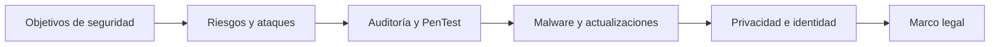

| Bloque | Contenido | Criterios asociados |
|---|---|---|
| 1 | UD01-C01 · Conceptos básicos | RA1.a, RA1.b |
| 2 | UD01-C02 · Activos y amenazas | RA4.b |
| 3 | UD01-C03 · Auditorías y PenTest | RA1.a |
| 4 | UD01-C04 · Malware y actualización | RA1.a |
| 5 | UD01-C05 · Privacidad | RA4.b |
| 6 | UD01-C06 · Identificación digital | RA4.f, RA4.g |
| 7 | UD01-C07 · Protección de datos | RA5.a–RA5.d |
| 8 | UD01-C08 · Servicios de la sociedad de la información | RA5.e |

---

## 1 · La seguridad es un proceso

<!-- content: UD01-C01 -->
<!-- criterios: RA1.a, RA1.b -->

Los sistemas sostienen actividades críticas: banca, sanidad, energía, comercio y comunicaciones.

**Seguridad informática** = medidas y controles que protegen los activos —hardware, software, firmware e información— mediante políticas, mecanismos y procedimientos continuos.

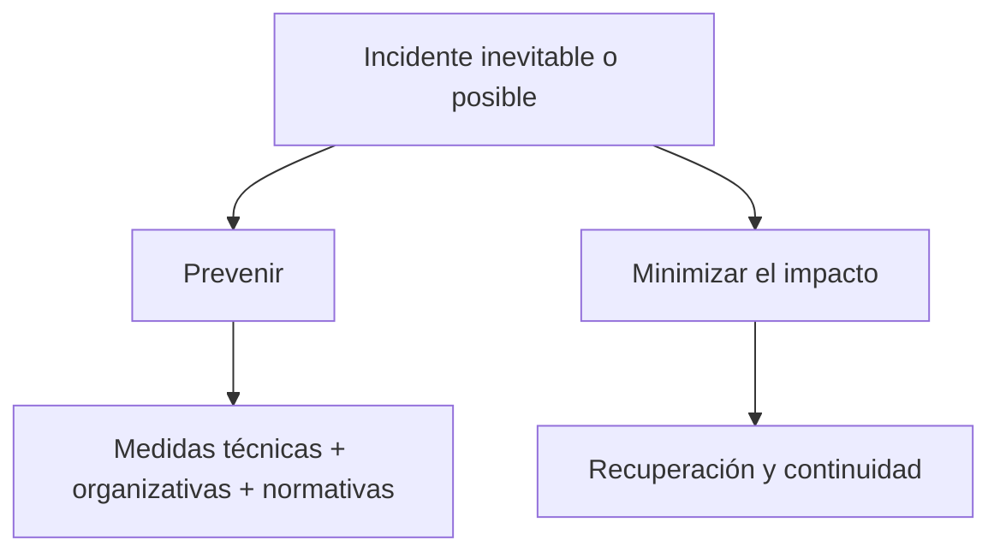

**Idea para debatir:** una puerta cerrada evita el robo; un seguro y una copia ayudan después. ¿Qué equivalentes informáticos encontrarías?

---

## 2 · Los cuatro objetivos: CIDN

<!-- content: UD01-C01 -->
<!-- criterios: RA1.a, RA1.b -->

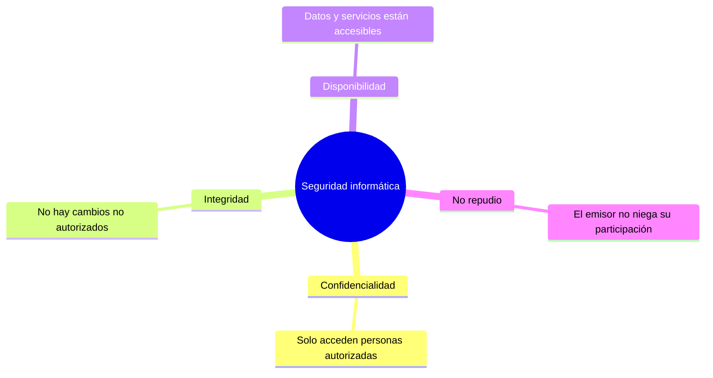

| Objetivo | Pregunta de control | Ejemplo |
|---|---|---|
| **C**onfidencialidad | ¿Quién puede verlo? | Expediente médico restringido |
| **I**ntegridad | ¿Ha sido alterado? | Boletín de notas sin cambios indebidos |
| **D**isponibilidad | ¿Está accesible cuando se necesita? | Tienda online durante alta demanda |
| **N**o repudio | ¿Puede negarse la autoría? | Factura firmada digitalmente |

**Pregunta rápida:** un ransomware que impide abrir los archivos afecta principalmente a C, I, D o N. Justifica tu elección.

---

## 3 · Mecanismos: del objetivo a la medida

<!-- content: UD01-C01 -->
<!-- criterios: RA1.a, RA1.b -->

| Mecanismo | Función principal | Objetivo que refuerza |
|---|---|---|
| Autenticación | Identificar al usuario, emisor o equipo | C / N |
| Autorización | Decidir a qué puede acceder quien ya se identificó | C / I |
| Cifrado | Ocultar información almacenada o transmitida | C |
| Firewall / proxy | Controlar conexiones y actuar de intermediario | C / D |
| Auditoría | Comprobar que las medidas funcionan | C / I / D |
| Copias de seguridad | Recuperar información tras un incidente | D / I |
| Anti-malware / IDS | Detectar actividad dañina o intrusiones | I / D |
| Certificado y firma electrónica | Vincular identidad y documento | N / I |

### Ejercicio de refuerzo · clasificación

En parejas, asignad a cada mecanismo uno o dos objetivos **CIDN** y defended una elección. Puede haber más de un objetivo, pero indicad cuál es el principal.

---

## 4 · Dos ejes de clasificación

<!-- content: UD01-C01 -->
<!-- criterios: RA1.a, RA1.b -->

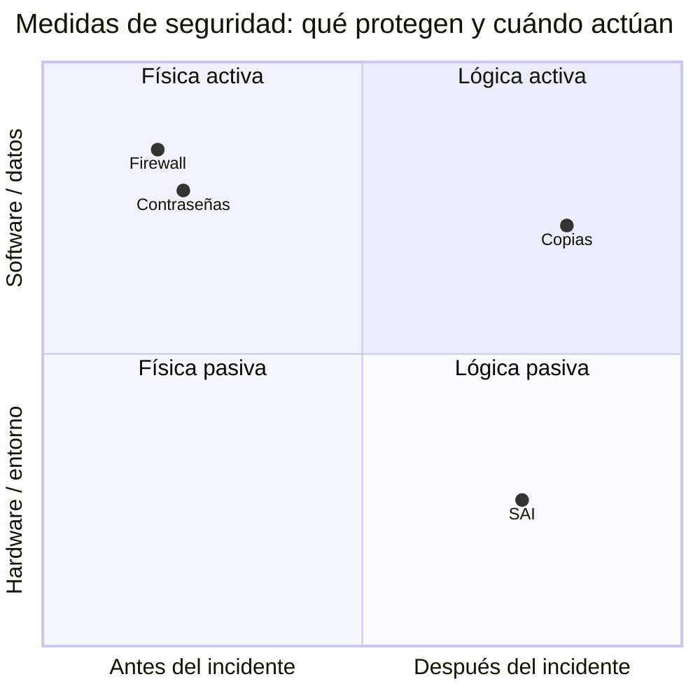

| Eje | Categoría | Ejemplos |
|---|---|---|
| Elemento protegido | **Física** | SAI, control de acceso, extintores |
| Elemento protegido | **Lógica** | Contraseñas, permisos, cifrado |
| Momento | **Activa** · previene | Firewall, antivirus, políticas |
| Momento | **Pasiva** · minimiza daños | SAI, copias, discos redundantes |

> **No confundir:** pasiva no significa “no hacer nada”; significa reducir el daño después del fallo.

---

## 5 · Del activo al impacto

<!-- content: UD01-C02 -->
<!-- criterios: RA4.b -->

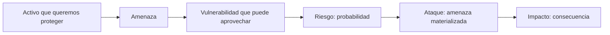

| Concepto | Pregunta útil | Ejemplo en una agencia |
|---|---|---|
| Activo | ¿Qué valor protegemos? | Datos de clientes |
| Amenaza | ¿Qué podría dañarlo? | Atacante, malware, incendio |
| Vulnerabilidad | ¿Qué debilidad existe? | Portátil sin actualizar |
| Riesgo | ¿Qué probabilidad hay? | Ataque al sistema vulnerable |
| Ataque | ¿Qué ocurrió realmente? | Explotación de la debilidad |
| Impacto | ¿Qué consecuencia produce? | Pérdida y filtración de datos |

---

## 6 · Análisis de riesgos y continuidad

<!-- content: UD01-C02 -->
<!-- criterios: RA4.b -->

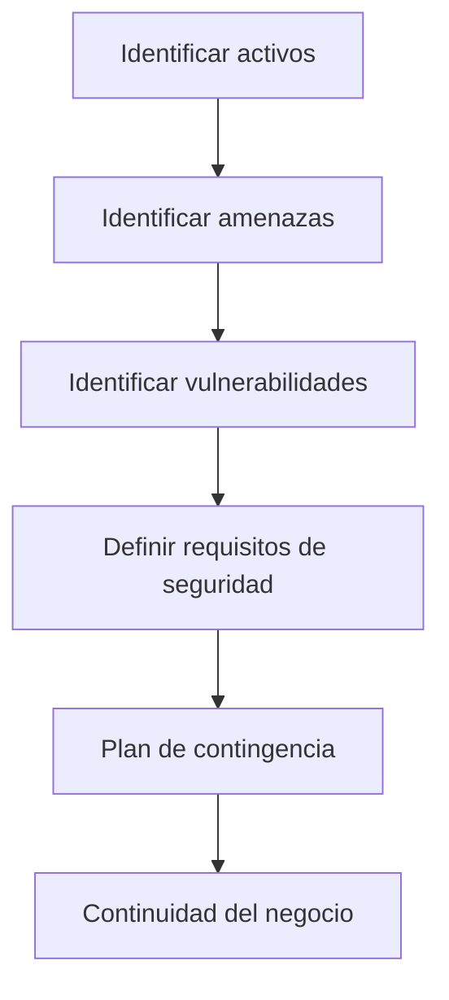

| Subplan | Cuándo actúa | Ejemplo |
|---|---|---|
| **Respaldo** | Antes | Copias, pararrayos, simulacros |
| **Emergencia** | Durante o justo después | Activar extinción, restaurar copias |
| **Recuperación** | Después del desastre | Local alternativo, reinstalación |

### Pregunta interactiva

Una agencia guarda todos sus datos en un único portátil. El equipo cae y queda inutilizado dos días. Identifica: **activo**, **vulnerabilidad**, **impacto** y una medida de respaldo.

---

## 7 · Vulnerabilidades y tiempo de reacción

<!-- content: UD01-C02, UD01-C04 -->
<!-- criterios: RA4.b, RA1.a -->

| Situación | ¿Afecta al sistema? | Respuesta |
|---|---:|---|
| Conocida en software instalado | Sí | Aplicar el parche disponible |
| Conocida en software no instalado | No | Mantener inventario y vigilar |
| Aún no conocida: **día cero** | Puede afectar | Reducir exposición y seguir avisos |

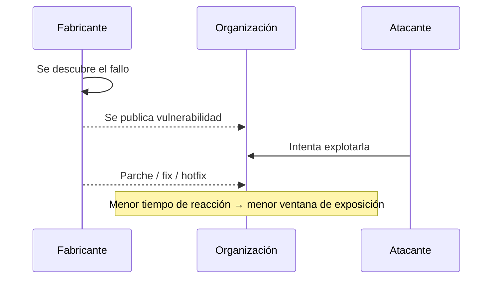

La vulnerabilidad se documenta mediante identificadores como **CVE**. El ciclo típico es: detección → prueba de concepto/exploit → solución → parche.

---

## 8 · Atacantes y ataques

<!-- content: UD01-C02 -->
<!-- criterios: RA4.b -->

| Perfil descrito en la unidad | Objetivo principal |
|---|---|
| **Cracker** | Romper la protección de un software |
| **Phreaker** | Aprovechar ilegalmente servicios de telecomunicaciones |
| **Crasher** | Dejar sistemas fuera de servicio, por ejemplo mediante DoS |
| **Hacker** | Saltarse la seguridad para acceder a zonas o información privilegiada |

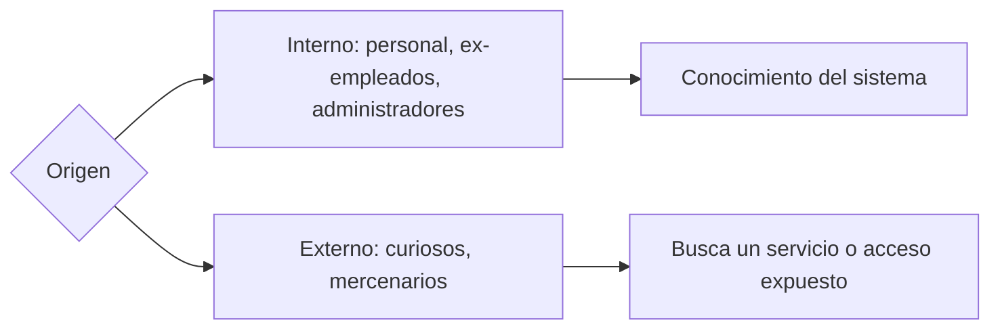

**Tipos de ataque:** fallos de software, malware, amenazas físicas e ingeniería social.

---

## 9 · Ingeniería social: atacar la confianza

<!-- content: UD01-C02 -->
<!-- criterios: RA4.b -->

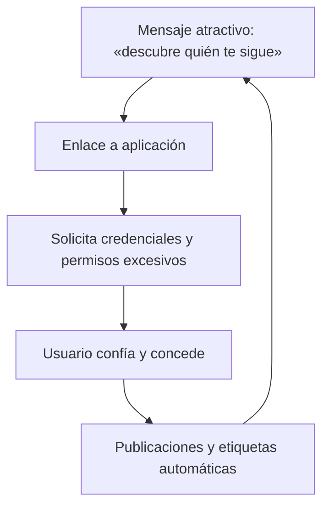

**Análisis del caso:**

- Ataque: ingeniería social orientada a obtener credenciales y propagarse.
- Vulnerabilidad: confianza del usuario y concesión de privilegios excesivos.
- Amenaza: suplantación de la identidad del usuario.
- Defensa: desconfiar de mensajes que apelan a la curiosidad y revisar permisos.

### Semáforo de decisión

Ante un enlace inesperado: **pausa → verifica el remitente → revisa permisos → no introduzcas credenciales**.

---

## 10 · Auditoría de seguridad

<!-- content: UD01-C03 -->
<!-- criterios: RA1.a -->

Una auditoría analiza el sistema para **identificar, enumerar y describir vulnerabilidades** en equipos, redes y servidores.

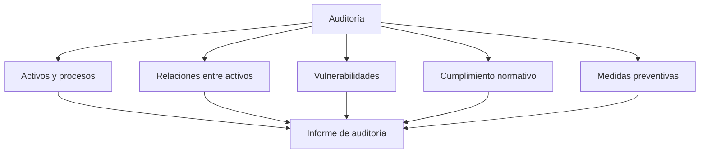

| Modalidad | Punto de partida |
|---|---|
| Interna / externa | Personal de la organización / empresa especializada |
| Caja negra | Sin credenciales ni información previa; visión externa |
| Caja blanca | Desde dentro, con información privilegiada |

> Un **PenTest** es una auditoría de caja negra que simula un atacante externo **con autorización expresa**.

---

## 11 · Fases de un test de intrusión

<!-- content: UD01-C03 -->
<!-- criterios: RA1.a -->

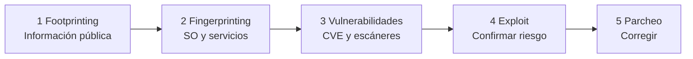

| Fase | Qué se busca | Herramientas citadas |
|---|---|---|
| Footprinting | Huella pública: DNS, WHOIS, buscadores, traceroute | Fuentes públicas |
| Fingerprinting | Inferir SO, puertos y versiones | Nmap, SuperScan, Netcat |
| Vulnerabilidades | Relacionar versiones con fallos | CVE, Nessus, GFI LanGuard |
| Exploit | Confirmar el riesgo de forma controlada | Metasploit |
| Parcheo | Aplicar la recomendación del fabricante | Actualizaciones |

**Regla profesional:** sin autorización, no es un PenTest; es una intrusión.

---

## 12 · Ejercicio guiado: diseña un informe

<!-- content: UD01-C03, UD01-C02 -->
<!-- criterios: RA1.a, RA4.b -->

**Situación:** una pequeña empresa publica una web, usa un servidor de correo y mantiene un portátil con datos de clientes.

En equipos, completad este esquema sin realizar pruebas sobre sistemas reales:

1. Activos y procesos que se auditarían.
2. Información pública que sería legítimo revisar.
3. Vulnerabilidades que habría que comprobar.
4. Medida correctora para cada hallazgo.
5. Evidencia que incluiría el informe.

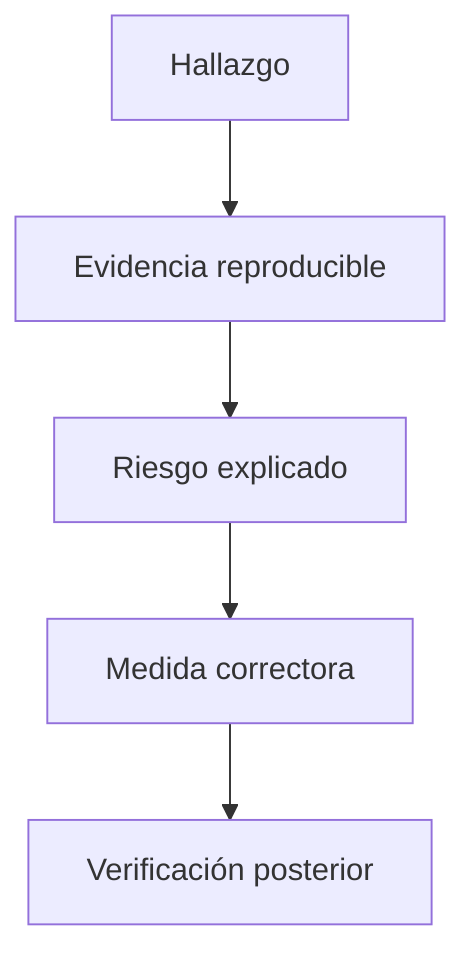

**Puesta en común:** ¿qué diferencia hay entre detectar un puerto y demostrar un impacto?

---

## 13 · Malware: tres patrones

<!-- content: UD01-C04 -->
<!-- criterios: RA1.a -->

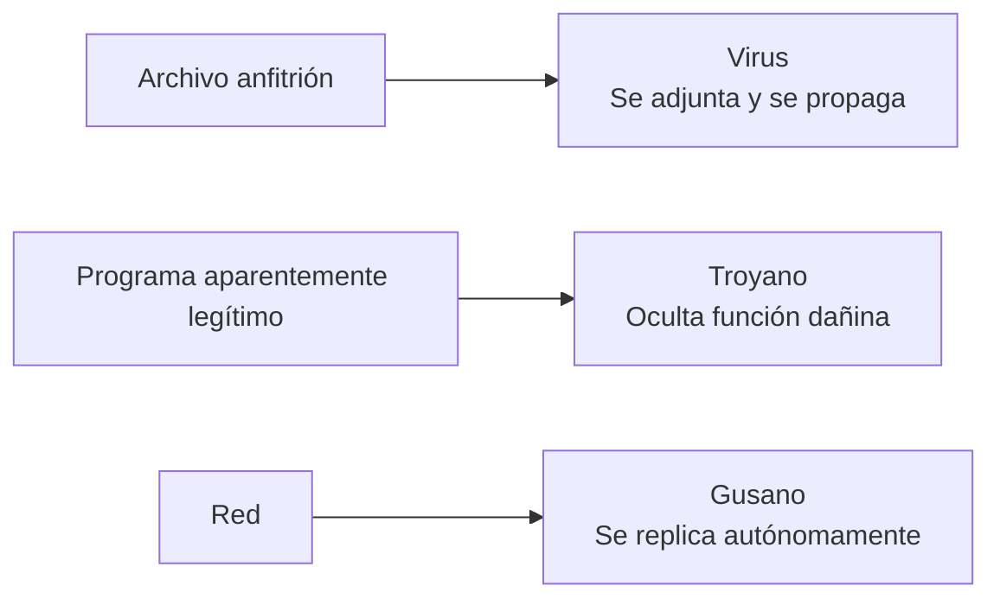

| Tipo | Cómo actúa | Analogía |
|---|---|---|
| **Virus** | Necesita un archivo o programa anfitrión | Parásito con huésped |
| **Troyano** | Parece útil, pero oculta una función maliciosa | Regalo envenenado |
| **Gusano** | Se propaga por la red sin archivo anfitrión | Plaga que se extiende sola |

Finalidades frecuentes: abrir puertas traseras, dañar datos o reproducirse masivamente.

**Pregunta:** un programa que aparenta ser una utilidad y abre una puerta trasera, ¿qué patrón describe mejor?

---

## 14 · Actualizar es cerrar una vulnerabilidad

<!-- content: UD01-C04, UD01-C02 -->
<!-- criterios: RA1.a, RA4.b -->

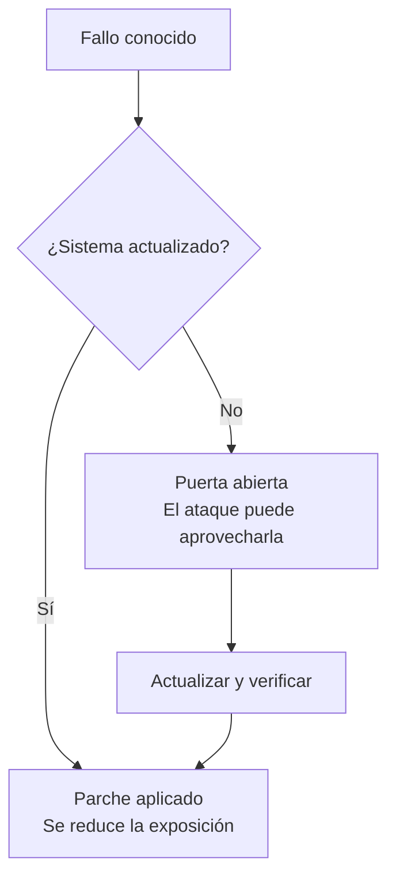

**Pautas combinadas:**

- actualizar sistema operativo y aplicaciones;
- usar firewall y detección de intrusos;
- instalar software de procedencia verificada;
- formar a las personas usuarias;
- mantener copias periódicas.

En Windows, los apuntes muestran `sfc` para verificar integridad; en sistemas Unix/Linux, `fsck` comprueba y repara la estructura del sistema de archivos.

```text
sfc /verifyonly   # comprueba sin modificar
sfc /scannow      # comprueba y repara
```

---

## 15 · Privacidad durante la transmisión

<!-- content: UD01-C05 -->
<!-- criterios: RA4.b -->

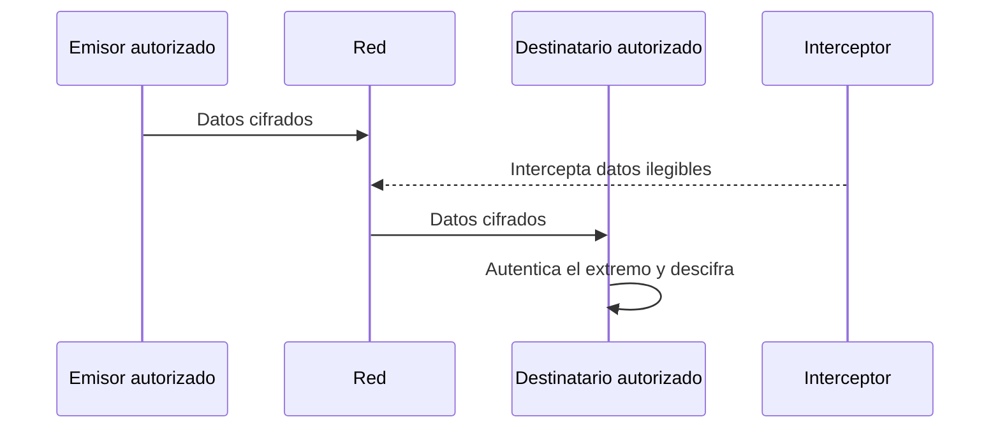

**Privacidad** aplica la confidencialidad al tratamiento y circulación de información personal o sensible.

| Medida | Qué evita o reduce |
|---|---|
| Cifrado de comunicaciones | Que un interceptor interprete los datos |
| Autenticación de extremos | Suplantación en la comunicación |
| Control de acceso a servicios | Exposición innecesaria de servicios |
| Usuario y contraseña | Acceso de personas no autenticadas |

> En esta unidad se introduce la finalidad; los protocolos y técnicas de cifrado se desarrollan posteriormente.

---

## 16 · Contraseñas: longitud y variedad

<!-- content: UD01-C05, UD01-C01 -->
<!-- criterios: RA4.b, RA1.a -->

| Longitud | Solo minúsculas | Mayúsculas + minúsculas + especiales |
|---:|---:|---:|
| 3 | Un suspiro | 1 segundo |
| 4 | Un suspiro y medio | 2 minutos |
| 5 | 10 segundos | Más de 2 horas |
| 6 | 5 minutos | Más de 9 días |
| 7 | Más de 2 horas | 2–3 años |
| 8 | Menos de 3 días | Alrededor de 2 siglos |

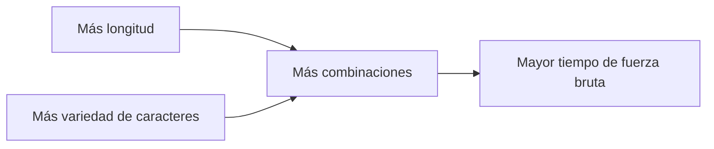

### Detecta malas prácticas

Marca cuáles aparecen en el caso: palabra de diccionario · contraseña compartida · envío en claro · guardado automático sin protección adicional · ausencia de política.

---

## 17 · Identidad digital: firma y certificado

<!-- content: UD01-C06 -->
<!-- criterios: RA4.f, RA4.g -->

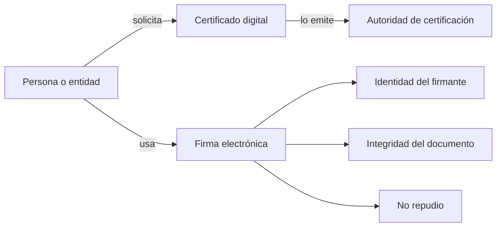

| Mecanismo | Aporta | Ejemplo |
|---|---|---|
| **Firma electrónica** | Vincula firmante y contenido; autoría e integridad | Firmar una declaración online |
| **Certificado digital** | Vincula identidad verificada con claves criptográficas | Identificarse ante una sede electrónica |

**Pregunta de contraste:** ¿en qué se parece una contraseña a una firma electrónica y en qué se diferencian respecto al no repudio?

---

## 18 · Caso de aplicación: ¿qué objetivo cubre?

<!-- content: UD01-C01, UD01-C05, UD01-C06 -->
<!-- criterios: RA1.a, RA1.b, RA4.b, RA4.f, RA4.g -->

Relaciona cada situación con el objetivo o mecanismo principal y explica por qué:

| Situación | Respuesta del equipo |
|---|---|
| Solo el personal sanitario accede a un historial | |
| Se detecta que una nota fue alterada | |
| Una web sigue operativa tras un pico de visitas | |
| El emisor no puede negar una factura firmada | |
| Se intercepta un mensaje cifrado | |

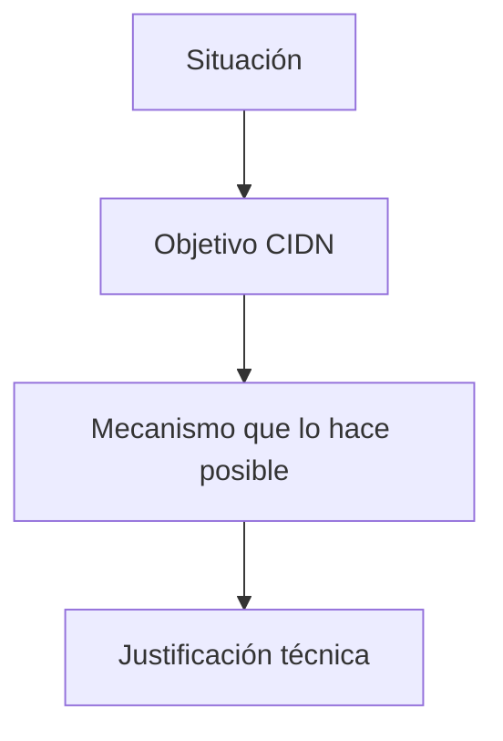

---

## 19 · Protección de datos: finalidad y alcance

<!-- content: UD01-C07 -->
<!-- criterios: RA5.a, RA5.b, RA5.c, RA5.d -->

Según el material de la unidad, la **LOPD (LO 15/1999)**, desarrollada por el **RD 1720/2007** y supervisada por la **AEPD**, protege los derechos fundamentales relacionados con datos personales.

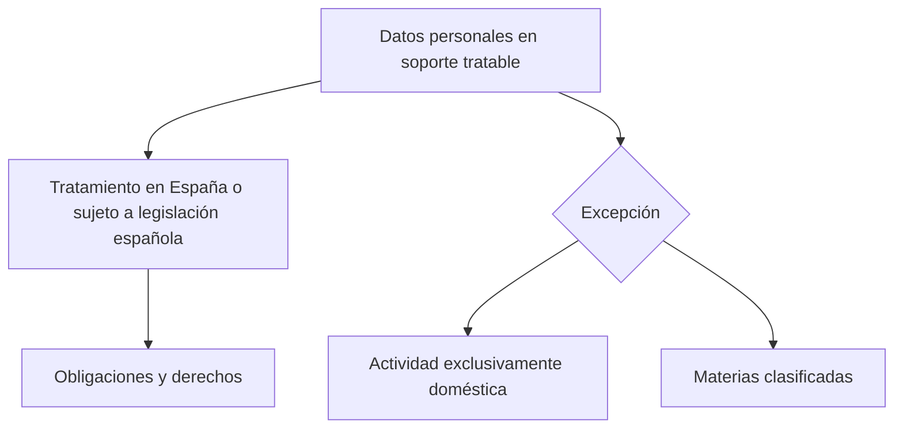

**Afecta a:** datos personales registrados susceptibles de tratamiento y tratamientos sometidos a la legislación española.

**No se aplica, según estos apuntes, a:** ficheros exclusivamente domésticos ni materias clasificadas.

---

## 20 · Nivel de seguridad: prevalece el más alto

<!-- content: UD01-C07 -->
<!-- criterios: RA5.a, RA5.b, RA5.c -->

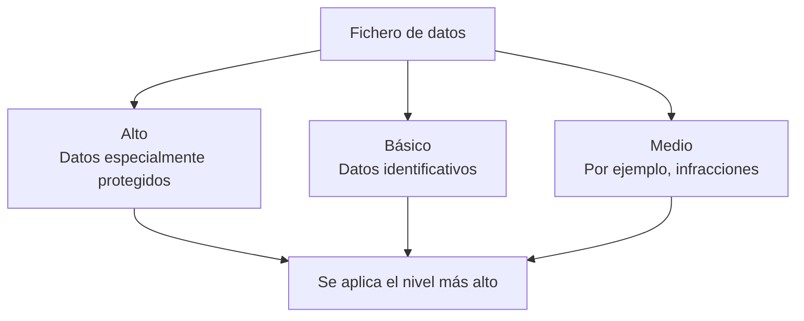

| Nivel | Ejemplo de datos |
|---|---|
| Básico | Datos identificativos |
| Medio | Datos relativos a infracciones |
| Alto | Salud, ideología, afiliación sindical |

### Mini-caso

Un fichero contiene datos identificativos y afiliación sindical. ¿Qué nivel prevalece? Explica por qué “añadir un dato” puede cambiar las medidas exigibles.

---

## 21 · Infracciones y sanciones de la LOPD

<!-- content: UD01-C07 -->
<!-- criterios: RA5.a, RA5.b, RA5.c, RA5.d -->

| Gravedad | Rango indicado en los apuntes | Ejemplo |
|---|---:|---|
| Leve | 900–40.000 € | Recoger datos sin informar previamente |
| Grave | 40.001–300.000 € | Usar el fichero para una finalidad distinta |
| Muy grave | 300.001–600.000 € | Recoger datos especialmente protegidos sin autorización |

**Caso SiTour · debate por equipos:** clasificad y razonad la gravedad de:

1. Enviar promociones sin solicitar la inscripción del fichero.
2. Recoger datos sin informar de su finalidad.
3. No atender solicitudes de rectificación o cancelación.

> No basta con nombrar la categoría: indicad qué obligación o derecho está implicado.

---

## 22 · Derechos y figuras implicadas

<!-- content: UD01-C07 -->
<!-- criterios: RA5.a, RA5.b, RA5.c, RA5.d -->

```mermaid
flowchart LR
    PERSONA[Persona interesada] -->|acceso, rectificación, cancelación, oposición| RESP[Responsable del fichero]
    RESP -->|aplica medidas y controla accesos| DATOS[Datos personales]
    AEPD[AEPD] -->|supervisa y exige cumplimiento| RESP
```

Para el profesional técnico, proteger datos implica **controlar accesos**, mantener medidas de seguridad y facilitar el ejercicio de los derechos reconocidos en el material.

**Pregunta interactiva:** ¿por qué una copia de seguridad, una contraseña y un registro de accesos pueden ser relevantes a la vez para la seguridad y para el cumplimiento legal?

---

## 23 · LSSI-CE: servicios y comercio electrónico

<!-- content: UD01-C08 -->
<!-- criterios: RA5.e -->

La **Ley 34/2002 (LSSI-CE)** regula el régimen jurídico de los servicios de la sociedad de la información y la contratación electrónica para las empresas incluidas en su ámbito.

```mermaid
flowchart TD
    SERV[Servicio de la sociedad de la información] --> INF[Información clara y obligatoria]
    SERV --> CON[Contratos electrónicos válidos]
    SERV --> INT[Intermediarios: alojamiento o enlaces]
    INT --> EX[Exención si no existe conocimiento efectivo de ilicitud]
```

| Obligación o efecto | Ejemplos del material |
|---|---|
| Información | Nombre, domicilio, correo, NIF y precios |
| Contratación | Validez legal de contratos electrónicos |
| Intermediación | Exención condicionada para alojamiento o enlaces |

---

## 24 · LOPD y LSSI-CE: no son lo mismo

<!-- content: UD01-C07, UD01-C08 -->
<!-- criterios: RA5.a, RA5.b, RA5.c, RA5.d, RA5.e -->

| | LOPD | LSSI-CE |
|---|---|---|
| Objeto | Datos de carácter personal | Servicios de la sociedad de la información y comercio electrónico |
| Pregunta central | ¿Cómo se trata y protege el dato? | ¿Qué obligaciones tiene quien presta el servicio? |
| Ejemplo | Control de acceso a un fichero de clientes | Información visible de una tienda online |
| Criterios | RA5.a–RA5.d | RA5.e |

```mermaid
flowchart LR
    TIENDA[Tienda online] --> D[Recoge datos de clientes]
    D --> LOPD[LOPD: protege el dato personal]
    TIENDA --> LSSI[LSSI-CE: regula el servicio y la contratación]
```

**Votación:** una tienda online puede estar sometida a ambas leyes. ¿Verdadero o falso? Justifica distinguiendo objeto y obligaciones.

---

## 25 · Reto final: mapa de protección

<!-- content: UD01-C01, UD01-C02, UD01-C04, UD01-C05, UD01-C06, UD01-C07, UD01-C08 -->
<!-- criterios: RA1.a, RA1.b, RA4.b, RA4.f, RA4.g, RA5.a, RA5.b, RA5.c, RA5.d, RA5.e -->

**Escenario:** una tienda online sufre un correo fraudulento, tiene un servidor sin parchear y conserva datos de clientes en un portátil sin copia.

En grupos, construid un mapa con:

1. activos, amenazas, vulnerabilidades, riesgos e impactos;
2. objetivos CIDN comprometidos;
3. medidas activas y pasivas;
4. fases de una auditoría que ayudarían a descubrirlo;
5. obligaciones legales relacionadas con los datos y el servicio.

```mermaid
flowchart TD
    S[Escenario] --> R[Riesgos]
    R --> CIDN[Objetivos CIDN]
    CIDN --> TEC[Medidas técnicas]
    CIDN --> ORG[Medidas organizativas]
    CIDN --> LEG[Obligaciones legales]
    TEC --> VER[Verificación mediante auditoría]
    ORG --> VER
    LEG --> VER
```

---

## 26 · Síntesis: una cadena de decisiones

<!-- content: UD01-C01, UD01-C02, UD01-C03, UD01-C04, UD01-C05, UD01-C06, UD01-C07, UD01-C08 -->
<!-- criterios: RA1.a, RA1.b, RA4.b, RA4.f, RA4.g, RA5.a, RA5.b, RA5.c, RA5.d, RA5.e -->

```mermaid
flowchart LR
    PROT[Proteger activos] --> OBJ[Definir CIDN]
    OBJ --> RIES[Analizar riesgos]
    RIES --> AUD[Auditar y verificar]
    AUD --> ACT[Actualizar y corregir]
    ACT --> PRIV[Preservar privacidad e identidad]
    PRIV --> CUM[Cumplir normativa]
    CUM --> MEJ[Revisar continuamente]
    MEJ --> PROT
```

**Si solo recuerdas una idea:** la seguridad no es instalar una herramienta; es un proceso continuo de prevención, detección, respuesta, recuperación y cumplimiento.

---

## 27 · Ideas clave y salida rápida

<!-- content: UD01-C01, UD01-C02, UD01-C03, UD01-C04, UD01-C05, UD01-C06, UD01-C07, UD01-C08 -->
<!-- criterios: RA1.a, RA1.b, RA4.b, RA4.f, RA4.g, RA5.a, RA5.b, RA5.c, RA5.d, RA5.e -->

- **CIDN:** confidencialidad, integridad, disponibilidad y no repudio.
- **Riesgo:** una amenaza puede aprovechar una vulnerabilidad y producir impacto.
- **PenTest:** auditoría autorizada; informa para corregir, no para dañar.
- **Malware:** virus, troyano y gusano responden a patrones distintos.
- **Actualizar:** reduce la ventana de exposición frente a vulnerabilidades conocidas.
- **Privacidad e identidad:** cifrado, autenticación, firma y certificado cumplen funciones relacionadas pero no idénticas.
- **Normativa:** LOPD protege datos personales; LSSI-CE regula servicios y contratación electrónica.

### Salida en un minuto

Escribe una frase para cada pregunta:

1. ¿Qué activo protegerías primero en tu contexto profesional?
2. ¿Qué vulnerabilidad puede convertirlo en un riesgo?
3. ¿Qué medida activa y qué medida pasiva aplicarías?
4. ¿Qué concepto de la unidad necesitas repasar?
